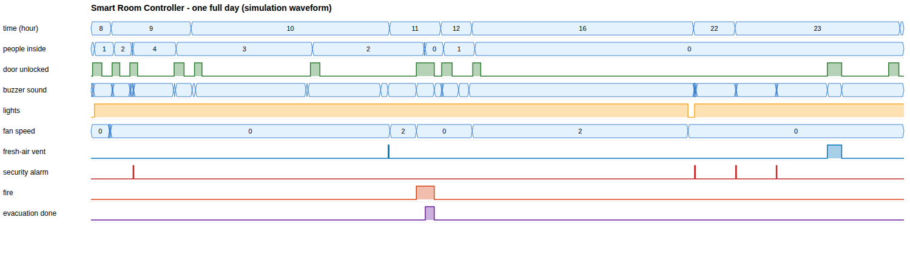

# Smart Room Controller — a digital chip for the SARTHIK Room door (Vivado, SystemVerilog)

No board, no wires, no components. Everything runs inside Vivado's free simulator.
Tested before delivery: **ALL 88 TESTS PASSED** in two different simulators (Verilator and Icarus), zero
warnings from a strict code checker, and 8 deliberately broken versions were all caught by the test.
Not tested here: Vivado itself (it cannot run in this cloud machine). The code uses only standard SystemVerilog that Vivado supports.

---

## 1. Explained like you are 5

Imagine the classroom has a **robot guard** standing at the door. The guard never sleeps, never gets
tired, never gets confused, and does every job **at the same time**.

- 🪪 You show your **card** and your **face** → the guard opens the door and says "beep" (welcome!).
- 🚫 A stranger shows a wrong face 3 times → the guard says "no more tries for 30 seconds".
- 👥 Two kids try to walk in on one card → the guard shouts "hey, one card = one person!".
- 🔥 There is smoke → the guard opens the door, turns the fan off, switches lights on, and rings the siren.
  When the last kid is out, the guard says "everyone is safe".
- 💡 Everyone goes home and forgets the lights → after one minute the guard switches them off.
- 🌙 At night the guard locks the room. If something moves inside the empty room → alarm.
- 📒 The guard writes everything in a notebook. If the internet is down, the notebook keeps it and
  sends it later, in the right order.

That robot guard is this **chip**. Your ESP32 is still the "smart brain" (face recognition, Wi-Fi,
Telegram). The chip is the **guard who never gets distracted**.

**Why does it matter?** Your ESP32 is busy with many jobs. When it checks a face it waits up to
6 seconds. When its memory got full it showed "Failed to allocate memory". A fire signal in that
moment would have to wait. The chip reacts in **10 nanoseconds** (100 million times faster than you
can blink), has no program that can crash, and no memory that can run out. Real buildings keep
safety rules in hardware for exactly this reason.

---

## 2. Every problem it solves, and how YOU can check it

Each line below matches a `PASS` line in the Tcl Console. If you see the PASS, that problem is solved.

| # | Problem in daily life | What the chip does | Check it (PASS line) |
|---|---|---|---|
| 1 | Someone uses only a stolen card | Door needs card **and** face | `card alone does NOT open the door` |
| 2 | Door stays unlocked after someone enters | Locks again by itself after 3 s | `door locks again by itself after 3 s` |
| 3 | Room too hot | Fan turns on, speed 1-2-3 by temperature | `33 C -> fan speed 2` |
| 4 | Fan keeps clicking on/off at the edge temperature | 1 °C "dead zone" (hysteresis) | `27 C -> fan stays 1` |
| 5 | Teacher must note late students by hand | Entry after 09:10 is marked LATE automatically | `LATE ENTRY sent to cloud` |
| 6 | Two people enter on one card (tailgating) | Beam counter sees 2 people, 1 ticket → alarm | `TAILGATING alarm` |
| 7 | Anyone can switch off an alarm | Only the **admin card** silences alarms | `alarm stopped only by admin card` |
| 8 | Room over-crowded | Door refuses new people when full | `room is FULL`, `door stays locked` |
| 9 | Stranger keeps trying faces | 3 wrong faces → 30 s lockout (re-tapping does not reset it) | `door LOCKED for 30 s` |
| 10 | People trapped inside during lockout | **Exit button always works** | `nobody is ever trapped` |
| 11 | Unknown card | Two "no" beeps + event to cloud | `UNKNOWN CARD sent to cloud` |
| 12 | Door left open (AC/heat escapes, anyone walks in) | Beeps every second after 20 s | `'close the door' beep every second` |
| 13 | Stuffy air → sleepy students | Fresh-air vent turns on | `fresh-air vent ON` |
| 14 | False fire alarm from dust | Smoke must last 3 s; a 1 s flicker is ignored | `glitch ignored: NO false fire alarm` |
| 15 | Real fire | Door unlocks, siren, **fan off** (no smoke spreading), lights on | `FIRE detected` + 5 lines |
| 16 | "Is everyone out?" during fire | Counter reaches 0 → EVACUATION DONE | `EVACUATION COMPLETE` |
| 17 | Wi-Fi down → events lost | 16-event memory keeps them in order; extra ones are **counted**, never silently lost | `16 events kept`, `in the right order` |
| 18 | Lights and fan left on in empty room | Switched off 60 s after the room empties | `lights and fan OFF by themselves` |
| 19 | Students entering at night | Normal cards refused 22:00–06:00 | `normal cards don't work at night` |
| 20 | Thief inside the empty room at night | Movement → intruder alarm + lights on | `INTRUDER alarm` |
| 21 | Door broken open | Opened while locked → loud alarm | `DOOR FORCED alarm` |
| 22 | Someone inside feels unsafe | Panic button → alarm + cloud event | `PANIC alarm` |
| 23 | Gas leak | Door unlocks, exhaust vent on, fan off (sparks), siren | `GAS detected` |
| 24 | ESP32 freezes / crashes | Chip notices in 10 s, logs it, safety keeps working | `chip notices ESP32 is DOWN`, `safety still works` |
| 25 | Daily attendance numbers | Counts present + late, resets at midnight | `today: 4 entries, 3 late` |

Different **sounds** so people know what happened without a screen:
1 short beep = welcome · 2 short beeps = no · beep every second = close the door ·
continuous = security alarm · on/off siren = fire or gas.

---

## 3. How the chip works (the 9 small blocks)

```
 ESP32 (card, face, clock, heartbeat) ──┐
 Buttons: exit, panic ──────────────────┤      ┌──────────── SMART ROOM CONTROLLER ────────────┐
 Sensors: door, 2 beams, motion, ───────┼────▶ │ sync_edge / debounce : clean the inputs        │
          smoke, gas, temperature, air  │      │ tick_gen      : makes 1 second and 0.1 second  │
                                        │      │ door_fsm      : card+face, lockout, forced,    │
                                        │      │                 held-open, exit always free    │
                                        │      │ people_counter: in/out, room full, tailgating  │
                                        │      │ room_comfort  : lights, fan 0-3, fresh-air vent│
                                        │      │ buzzer        : 5 different sounds             │
                                        │      │ event_logger  : 16-event memory for the cloud  │
                                        │      └───┬────────────────────────────────────────────┘
                                                   ▼
                     door lock, buzzer, lights, fan, vent, alarms, events → ESP32 → cloud
```

| File (folder `rtl/`) | In one line |
|---|---|
| `smart_room_pkg.sv` | Names of all events and sounds |
| `tick_gen.sv` | The chip's clock: one pulse every second |
| `sync_edge.sv` | Safely receives signals from the ESP32 |
| `debounce.sv` | Ignores short glitches (switch bounce, dust on the smoke sensor) |
| `door_fsm.sv` | The door "brain" (a finite state machine) |
| `people_counter.sv` | Counts people with two light beams, detects tailgating |
| `room_comfort.sv` | Lights, fan speed, fresh-air vent |
| `buzzer.sv` | Makes the 5 sounds |
| `event_logger.sv` | FIFO memory: keeps events while Wi-Fi is down |
| `smart_room_top.sv` | Connects everything + night lock, late marking, alarms, ESP32 watchdog, attendance |
| `tb/tb_smart_room.sv` | The test: one full day, 88 automatic checks |

---

## 4. Install Vivado (one time, free)

1. Go to **amd.com**, top-right **Sign In** → **Create account** (free). Verify your e-mail.
2. On amd.com search **"Vivado download"** and open the **Downloads** page for Vivado.
3. Pick version **2025.2** if it is offered (no licence needed). If only 2026.x is offered, take it — it uses
   the free **BASIC** licence that you generate once a year from the same site.
4. Download the **Windows Self Extracting Web Installer**. Log in again when asked.
5. Run it. Screens:
   - *Select Product to Install* → **Vivado**
   - *Select Edition* → **Vivado ML Standard** (the free one) or **BASIC** on 2026.x
   - *Devices* → untick everything except **7 Series → Artix-7** (makes the download much smaller)
   - Install folder: keep `C:\AMDDesignTools` (or `C:\Xilinx`). Click **Install**. It takes a long time.
6. Laptop: Windows 10/11, 16 GB RAM is best (8 GB works, slower), plenty of free disk space.

If a screen name is slightly different in your version, choose the option that says **free / Standard / BASIC**.

---

## 5. Run the project (about 5 minutes)

1. Download the project ZIP (`Smart_Room_Controller.zip`) to your laptop.
2. Right-click it → **Extract All…** → type `C:\` → **Extract**.
   You must now have the folder **`C:\Smart_Room_Controller`** containing `create_project.tcl`, `rtl`, `tb`.
   (No spaces in the path! If Windows made `C:\Smart_Room_Controller\Smart_Room_Controller`, use that inner path below.)
3. Open **Vivado** (Start menu → *Vivado 20xx.x*).
4. At the bottom of the Vivado start screen click the **Tcl Console** tab.
5. Click inside the console and type, pressing **Enter** after each line:
   ```
   cd C:/Smart_Room_Controller
   source create_project.tcl
   ```
   (Use forward slashes `/`.)
6. Wait 1–3 minutes. Vivado creates the project, runs the test and opens the waveform.

---

## 6. What the output looks like

**A. Tcl Console** (scroll up to read it all — the full text is in `docs/expected_output.txt`):

```
==============================================================
  SMART ROOM CONTROLLER - one full day at the classroom door
  (room size for this test = 4 people)
==============================================================

[08:50] Morning. Power on.
    PASS  door is locked
    PASS  room empty, lights off (no power wasted)
    PASS  no alarm, buzzer quiet

[08:55] Ravi taps his card (class starts 09:00)
    PASS  card alone does NOT open the door (face needed)
           cloud <- ENTRY           time 08:55  people=0
    PASS  face OK -> door unlocks
    ...
[11:00] Real smoke (lasts more than 3 s)
    PASS  FIRE detected
    PASS  door unlocked for escape
    PASS  siren sound
    PASS  fan OFF (fan would spread smoke)
    ...
==============================================================
  Events sent to cloud: 32    lost while Wi-Fi was down: 4
  ALL 88 TESTS PASSED
==============================================================
```

**B. Waveform window** — click **Zoom Fit** (magnifier icon with square brackets) to see the whole day:



How to read it: a green block on *door unlocked* = door open. *people inside* goes 1 → 2 → 4 → 3 → 2 → 0.
At 11:00 *fire* goes high, *door unlocked* stays high, *fan speed* drops to 0, then *evacuation done* rises
when people reaches 0. At 22:00–23:00 the red spikes are the intruder, forced-door and panic alarms.

**If you see the waveform but no PASS lines:** type `run all` in the Tcl Console and press Enter.
**If any line says FAIL:** copy the Tcl Console text and send it to Claude.

---

## 7. Get chip numbers for your report (still no board)

1. Left panel **Flow Navigator** → **SYNTHESIS** → **Run Synthesis** → OK. Wait until the top-right says *synth_design Complete*.
2. In the pop-up choose **Open Synthesized Design** → OK.
3. Menu **Reports** → **Report Utilization…** → OK. Note **Slice LUTs** and **Slice Registers** (flip-flops).
4. Menu **Reports** → **Timing** → **Report Timing Summary…** → OK. If **WNS** is positive, the chip meets 100 MHz.
5. Screenshot both tables for your report.

For nice waveform screenshots: click a signal name, right-click → **Signal Color** to colour it; **View → Zoom Fit**.

---

## 8. Viva / interview answers

- **"What did you build?"** A hardware safety-and-room controller in SystemVerilog: finite state machines for door access,
  lockout and emergency; a glitch filter for sensors; a bidirectional people counter with tailgating detection;
  a FIFO event buffer for Wi-Fi outages; an ESP32 watchdog; verified with a self-checking testbench.
- **"Why not just the ESP32?"** The ESP32 stays the smart brain (face recognition, cloud). The chip is a separate
  safety layer: it reacts in nanoseconds, never blocks, never runs out of memory, and keeps working if the ESP32 crashes.
- **"How do you know it works?"** 88 automatic checks across a full simulated day; 8 deliberately injected bugs were all
  detected; lint-clean; synthesised in Vivado for an Artix-7 FPGA.
- **"Is it connected to the real door?"** Not yet — verified in simulation. Next step: an FPGA board wired to the ESP32.

---

## 9. Honest limits

- Simulation only. The real door still runs on the ESP32; do not claim the chip controls it today.
- Light beams, motion, gas, temperature and air sensors do not exist in the hardware yet (future Stage 2/4).
- In the test one "second" is 100 clock cycles so it runs fast; the real chip setting is 100 MHz (`CLKS_PER_SEC`).
- Room size is 4 in the test (easy to fill); the real setting is 40 (`MAX_PEOPLE`).
